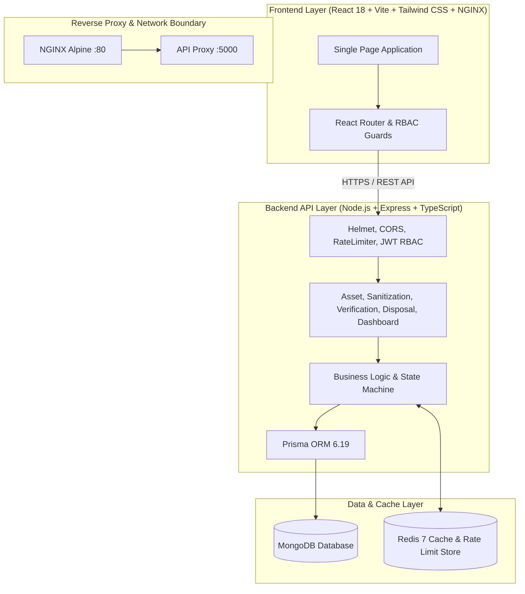
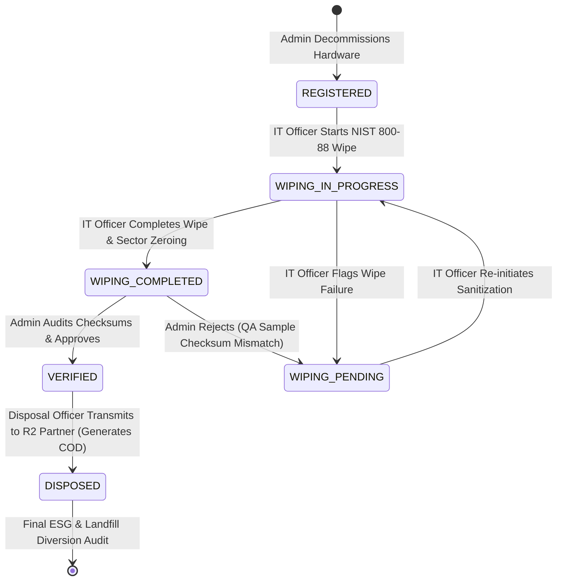

# ASSETGUARD — Secure IT Asset Lifecycle Management Platform

[](https://www.typescriptlang.org/)
[](https://reactjs.org/)
[](https://expressjs.com/)
[](https://www.mongodb.com/)
[](https://www.prisma.io/)
[](https://redis.io/)
[](https://www.docker.com/)
[](#compliance--standards)

---

## 📌 Executive Summary

**ASSETGUARD** is an enterprise-grade, production-ready Secure IT Asset Lifecycle Management Platform built on the **MERN + Prisma** architecture. It enforces rigid chain-of-custody tracking, cryptographic data sanitization workflows compliant with **NIST SP 800-88 Rev 1** and **DoD 5220.22-M**, strict dual-custody administrator verification, physical disposition / certified R2 e-waste recycling tracking, and automated generation of **Certificates of Destruction (COD)**.

Built with a resilient multi-tier architecture, AssetGuard utilizes **MongoDB** as the primary document database with **Prisma** for type-safe database access, guarantees zero data leakage risk, complete audit readiness for ESG and compliance mandates, sub-millisecond dashboard analytics via **Redis** caching and rate limiting, and turnkey Docker container orchestration.

---

## 🏛️ System Architecture

AssetGuard employs a decoupled client-server architecture with MongoDB for document persistence, Redis for caching and distributed rate limiting, and NGINX for static asset delivery.



---

## 🔄 End-to-End Asset Disposition Lifecycle

AssetGuard enforces a deterministic, state-machine driven disposition pipeline with cryptographic audit trails:



| Lifecycle State | Description | Permitted Action | Role Authorized |
|---|---|---|---|
| `REGISTERED` | Decommissioned device added to inventory. | Initiate Data Wipe | `IT_OFFICER`, `ADMIN` |
| `WIPING_PENDING` | Awaiting technician sanitization or re-wipe following rejection. | Initiate Data Wipe | `IT_OFFICER`, `ADMIN` |
| `WIPING_IN_PROGRESS` | Actively undergoing NIST 800-88 / DoD multi-pass erasure. | Complete Wipe / Flag Fail | `IT_OFFICER`, `ADMIN` |
| `WIPING_COMPLETED` | Erasure finished; disk sectors zeroed. Awaiting QA audit. | Verify / Reject | `ADMIN` (Strict) |
| `VERIFIED` | Cryptographic hash match confirmed; certified clean. | Record Disposition | `DISPOSAL_OFFICER`, `ADMIN` |
| `DISPOSED` | Hardware shredded or recycled; Certificate of Destruction stamped. | View Certificate (COD) | `ADMIN`, `DISPOSAL_OFFICER`, `IT_OFFICER` |

---

## 🛡️ Role-Based Access Control (RBAC) Matrix

AssetGuard enforces strict dual-custody governance. Technicians who wipe drives cannot approve their own sanitization certificates, ensuring tamper-proof compliance.

| System Capability / Endpoint | `ADMIN` | `IT_OFFICER` | `DISPOSAL_OFFICER` |
|---|:---:|:---:|:---:|
| **View Dashboard & Real-Time Analytics** | ✅ | ✅ | ✅ |
| **Asset Inventory (Create, Update, Delete)** | ✅ | ❌ (Read Only) | ❌ (Read Only) |
| **Start & Complete NIST 800-88 Wiping** | ✅ | ✅ | ❌ |
| **Mark Wiping as Failed & Preserve Audit** | ✅ | ✅ | ❌ |
| **QA Audit & Approve Sanitization (`VERIFY`)** | ✅ *(Strict)* | ❌ *(Forbidden)* | ❌ *(Forbidden)* |
| **QA Reject Sanitization (`REJECT`)** | ✅ *(Strict)* | ❌ *(Forbidden)* | ❌ *(Forbidden)* |
| **Execute Physical Disposition & R2 Recycling** | ✅ | ❌ | ✅ |
| **Generate Certificate of Destruction (COD)** | ✅ | ❌ | ✅ |
| **Export Compliance & ESG Regulatory CSVs** | ✅ | ✅ | ✅ |

---

## 🚀 Quickstart Guide

### Option 1: Docker Compose (Recommended for Submission / Production)

AssetGuard is fully containerized. A single command provisions MongoDB, Redis, the compiled Node.js backend, and the NGINX React frontend:

```bash
# 1. Clone repository
git clone https://github.com/Kabycoder/AssetGuard.git
cd AssetGuard

# 2. Launch all microservices in detached mode
docker compose up -d --build

# 3. View service status & healthchecks
docker compose ps
```

Once launched, access the platform:
- **Frontend Dashboard**: [http://localhost](http://localhost) (Port 80)
- **Backend Health Check**: [http://localhost:5000/api/v1/health](http://localhost:5000/api/v1/health)
- **MongoDB Database**: `localhost:27017` (`assetguard`)
- **Redis Cache**: `localhost:6379`

To stop and remove containers:
```bash
docker compose down -v
```

---

### Option 2: Local Development Setup

#### Prerequisites
- Node.js 20 LTS or higher
- npm 10+
- MongoDB 6+ / 7+ (Optional: platform includes seamless offline in-memory fallback)
- Redis 7+ (Optional: includes automatic in-memory fallback cache and rate limit store)

#### 1. Backend Service Setup
```bash
cd server

# Install dependencies
npm install

# Setup environment variables
cp .env.example .env

# Generate Prisma Client & Push MongoDB Schema (if MongoDB is active)
npm run db:generate
npm run db:push
npm run db:seed

# Start development server with live reload
npm run dev
```

#### 2. Frontend Client Setup
```bash
cd ../client

# Install dependencies
npm install

# Setup environment variables
cp .env.example .env

# Start Vite development server
npm run dev
```
Access the application at [http://localhost:5173](http://localhost:5173).

---

## 🧪 Automated Testing & Verification Suite

AssetGuard includes a full suite of **93 comprehensive automated tests** across 4 dedicated test runners with 100% pass rates:

```bash
# Run all automated test suites sequentially
cd server
npm run test:all
```

### Individual Test Suites:
| Test Command | Scope | Result |
|---|---|:---:|
| `npm run test:e2e` | Complete End-to-End Asset Disposition Lifecycle, Security Headers, Rate Limits, and RBAC | **19/19 PASSED** |
| `npm run test:sanitization` | Phase 5 NIST 800-88 / DoD 5220.22-M Wiping, Transitions, Failure Handling | **24/24 PASSED** |
| `npm run test:verification` | Phase 6 Admin QA Verification, Rejection Reason Stamping, Tamper Prevention | **21/21 PASSED** |
| `npm run test:dashboard` | Phase 7 Real Database Aggregations, Redis Caching (60s TTL), Cache Invalidation Hooks | **29/29 PASSED** |
| **Total Test Coverage** | **All System Capabilities & Edge Cases** | **93/93 PASSED (100%)** |

---

## 🌐 API Reference

All protected API endpoints require an `Authorization: Bearer <JWT_TOKEN>` header.

### 1. System & Authentication
- `GET /api/v1/health` — Service healthcheck, uptime, and database/Redis status.
- `POST /api/v1/auth/login` — Authenticates credentials, returns signed JWT (`ADMIN`, `IT_OFFICER`, `DISPOSAL_OFFICER`).
- `GET /api/v1/auth/me` — Returns authenticated user profile and active permissions.

### 2. Asset Management
- `GET /api/v1/assets` — Paginated, searchable, filtered asset inventory.
- `GET /api/v1/assets/:id` — Asset detail with wiping and disposition history.
- `POST /api/v1/assets` — Register decommissioned hardware (`ADMIN` only).
- `PUT /api/v1/assets/:id` — Update hardware metadata (`ADMIN` only).
- `DELETE /api/v1/assets/:id` — Archive asset record (`ADMIN` only).

### 3. Data Sanitization (NIST 800-88)
- `GET /api/v1/sanitization` — Sanitization queue and active wiping tasks.
- `GET /api/v1/sanitization/:assetId` — Complete wiping history for a specific asset.
- `POST /api/v1/sanitization/:assetId/start` — Initiate data wipe (`IT_OFFICER`, `ADMIN`).
- `POST /api/v1/sanitization/:assetId/complete` — Finalize wipe and attach algorithm specs (`IT_OFFICER`, `ADMIN`).
- `POST /api/v1/sanitization/:assetId/fail` — Flag sector wipe failure and return to pending (`IT_OFFICER`, `ADMIN`).

### 4. Admin Verification & Audit
- `GET /api/v1/verification` — Queue of wiped assets awaiting QA verification.
- `GET /api/v1/verification/:assetId` — Detailed sector audit checklist and technician logs.
- `POST /api/v1/verification/:assetId/verify` — Approve sanitization; transition to `VERIFIED` (`ADMIN` strictly).
- `POST /api/v1/verification/:assetId/reject` — Reject sanitization with mandatory reason (`ADMIN` strictly).

### 5. Final Disposition & Recycling
- `GET /api/v1/disposal` — Queue of `VERIFIED` assets awaiting disposal + completed disposition ledger.
- `GET /api/v1/disposal/:assetId` — Certificate of Destruction (COD) and vendor manifest details.
- `POST /api/v1/disposal/:assetId` — Record physical destruction or certified recycling (`DISPOSAL_OFFICER`, `ADMIN`).

### 6. Dashboard & Analytics
- `GET /api/v1/dashboard` — Aggregated KPI summaries, 6-stage lifecycle distribution, asset type breakdown, and live activity stream (Redis-cached).

---

## 🔒 Security & Hardening Features

- **Zero-Secrets Policy**: Zero credentials, API keys, or JWT secrets hardcoded in source code or Docker layers.
- **Cryptographic Password Hashing**: Passwords stored using `bcryptjs` with high-work-factor salt rounds.
- **Strict Role-Based Access Control**: Dual-custody enforcement prevents privilege escalation or self-verification.
- **Resilient Distributed Rate Limiting**: Redis-backed rate limiting (`apiLimiter`: 100 req/15m, `authLimiter`: 10 req/15m) with automatic in-memory fallback.
- **HTTP Security Headers**: Powered by `helmet` (`X-Frame-Options`, `X-Content-Type-Options`, `X-XSS-Protection`, `Referrer-Policy`).
- **Container Isolation**: Multi-stage Docker builds running under non-root `node` and unprivileged NGINX users.

---

## 📜 Compliance & Standards

- **NIST SP 800-88 Rev. 1**: Guidelines for Media Sanitization (Clear, Purge, Destroy).
- **DoD 5220.22-M**: National Industrial Security Program Operating Manual (7-Pass Overwrite).
- **R2v3 Standard**: Responsible Recycling standards for electronics recycling partners.
- **e-Stewards Standard**: Global standard for certified electronics refurbishing and zero-landfill e-waste.

---

## 👥 Demo User Accounts

| Role | Email | Password | Primary Workspace / Purpose |
|---|---|---|---|
| **Administrator** | `admin@assetguard.local` | `Admin@123456` | QA Verification, Asset Management, Governance |
| **IT Officer** | `it@assetguard.local` | `Officer@123456` | NIST 800-88 Data Sanitization, Erasure Execution |
| **Disposal Officer** | `disposal@assetguard.local` | `Disposal@123456` | R2 Partner Logistics, Certificate of Destruction (COD) |

---

## 📄 License & Academic Attribution

This project is developed as part of academic / professional IT Asset Disposition and Data Security research. Distributed under the MIT License.
